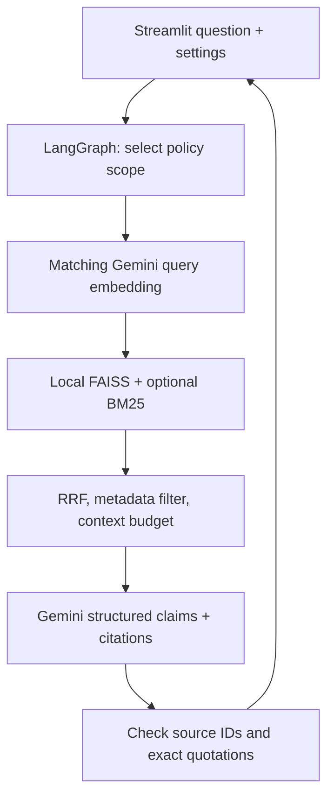

# Campus Evidence — Streamlit + LangChain RAG agent

A working classroom knowledge assistant powered by Gemini, a bounded LangGraph workflow, and **local FAISS**. It imports the supplied DSU embeddings directly, searches their matching source chunks, and displays answers with inspectable supporting quotations. It also includes a separate fictional company corpus for the assignment's policy and security tests.

No API key is included. This is a classroom prototype, not a verified university policy service.

## Start in three commands

Use Python **3.12**. From this directory:

```bash
python -m venv .venv
# Windows: .venv\Scripts\activate
# macOS / Linux: source .venv/bin/activate
python -m pip install -r requirements.txt
```

Copy `.env.example` to `.env` and put your own key in `GEMINI_API_KEY`. Then run:

```bash
streamlit run streamlit_app.py
```

Open the URL printed by Streamlit. The default dataset is DSU. Select **Noor Skills · fictional assignment** in the sidebar to run the rubric examples. The first demo launch generates its embeddings; the supplied DSU corpus needs no document re-embedding.

## What is implemented

| Assignment task | Implementation and reviewable evidence |
| --- | --- |
| Business use case | DSU student admissions lookup; separate Noor Skills Institute fictional business in `knowledge/demo/01_company_overview.md` |
| Five knowledge documents, 1,500–2,500 words | Five fictional Markdown documents, **1,884 words**, eight course offerings, exact prices/times, two exceptions and deliberately missing facts |
| Current and archived policies | Fictional v2.0 effective 2026-01-01 and archived v1.0 effective 2025-01-01; changed processing fee and attendance threshold; unchanged refund window |
| Load and split documents | `rag/store.py`: Markdown, TXT and text PDF loaders; LangChain recursive character splitting with source/version/status metadata |
| Generate embeddings | `rag/embeddings.py`: Gemini `gemini-embedding-001`, 1,536 dimensions, explicit document/query task types, explicit L2 normalization |
| Local vector store | `FAISS IndexFlatIP`, wrapped by LangChain FAISS; local NumPy and JSON assets; no vector database service |
| Retrieve, ground and answer | `rag/retrieval.py` + `rag/agent.py`; LangGraph route → retrieve → answer, structured Gemini claims and validated quotation citations |
| Explain missing information | Exact required refusal; helpful empty-question, missing-key and provider-error messages |
| Inspect sources | Filenames, policy metadata, exact excerpts, all retrieved chunks, retrieval scores and context IDs in expandable UI sections |
| Policy routing and conflicts | Metadata filtering before top-k; explicit comparison mode; unresolved DSU snapshots are not fabricated policy changes |
| Prompt-injection tests | Two harmless instructions stored inside the fictional operations document; evaluation checks that the attack entered the context |
| Six-question k comparison | `evidence/retrieval_k_comparison.csv`: same six questions at k=1,3,5, frozen documents and chunking |
| Chunking investigation | `evidence/chunking_comparison.csv`: three questions at 1,000/150 versus 600/100 characters of size/overlap |
| Optional retrieval improvement | Semantic vs BM25+semantic RRF on the same six questions in `evidence/hybrid_comparison.csv`; optional LLM rewriting/reranking in UI |
| 20-question test set | `evaluation/test_cases.json`, written before evaluation: 5 direct + 4 paraphrased + 3 two-document + 3 policy comparisons + 3 missing + 2 injection |
| Actual results and reasons | `evidence/test_results_20.csv`: expected/actual answers, sources, supporting quotations, PASS/FAIL/BLOCKED and explanations |
| Short report and demonstration | `docs/project-report.pdf`, `docs/demo-walkthrough.mp4`, and `docs/demo-script.md` |
| Live policy-change challenge | Demo corpus content fingerprints invalidate cached indexes when source text or chunk settings change; explicit rebuild command below |

**Requested variation:** the PDF specifies Chroma. This implementation uses **FAISS**, as explicitly requested. It does not claim to satisfy a Chroma-specific implementation check. The real DSU corpus also cannot establish the fictional-business or authenticated previous-policy requirements, so the separate fictional dataset supplies those demonstrations without mixing invented facts into DSU answers.

## Supplied embeddings: exact compatibility

The supplied bundle contains **584 vectors × 1,536 float32 dimensions**, generated with `gemini-embedding-001`. `data/dsu/vectors.npy` preserves those vectors; `data/dsu/chunks.jsonl` preserves their row order and source content. Redundant per-record JSON embeddings were removed to avoid duplicating the matrix.

At startup, the app validates row count, dimension, finite values and IDs, normalizes vectors, and builds a local exact FAISS index. It does **not** substitute another embedding model. Query embeddings explicitly use `RETRIEVAL_QUERY`; rebuilt documents use `RETRIEVAL_DOCUMENT`. Both are L2 normalized, so inner product is cosine similarity. Changing the query embedding model or dimensions without rebuilding the corpus would break retrieval compatibility.

FAISS is reconstructed locally from the supplied matrix at startup, rather than shipping duplicate index bytes. The demo stores its generated vectors/JSON in `.cache/indexes/<content-hash>/`. No pickle deserialization is required. No downloaded embedding model is included.

Verify this without an API call:

```bash
python -m scripts.verify_bundle
```

The script checks the 584-row shape, unit norms, and a real FAISS self-search returning row 0 with cosine 1.0. `original_manifest.json` retains the uploaded bundle's provenance; its original probe scores are not misrepresented as newly executed tests.

The original full DSU PDFs are not included. The app cites the original filenames and source URLs attached to each supplied excerpt. `knowledge/dsu/` contains the provided curated summaries for inspection. Editing these summaries does not alter the original embedded snapshots.

## How the components communicate



The app shares one immutable corpus resource across sessions and keeps each user's conversation in that session's memory. Every question is independent: chat history is displayed but never treated as source evidence. Users should include the course or policy name in follow-up questions.

### Retrieval and policy selection

- **Semantic:** exact FAISS cosine search.
- **Keyword:** BM25 exact-term search.
- **Hybrid default:** reciprocal rank fusion, `sum(1 / (60 + rank))`. Raw BM25 scores and cosine scores are not added together.
- Archived records are excluded **before** selecting current top-k results. Explicit historical questions exclude current-policy records while allowing reference documents.
- Comparisons with k≥2 reserve slots for both current and archived policy candidates when available. k=1 cannot provide two-policy evidence; this is intentionally measurable in the experiment.
- Query rewrite and LLM re-ranking are optional, separate Gemini calls. They are extensions inspired by the notebook, not claimed to be cross-encoder models.
- Context packing uses a conservative UTF-8 byte bound with room for wrappers. Oversized passages are skipped, never invisibly truncated into a different quotation. All retrieved chunks remain inspectable even when the context budget excludes a chunk.

### Trust and its limits

Retrieved documents are untrusted data, separated from system instructions. The answer schema requires cited factual claims. Unknown IDs, missing citations and invented/noncontiguous quotations fail closed. One repair call may regenerate an invalid quotation using the **same evidence**; if it still fails, the assistant refuses.

An exact quotation check proves that a quote exists. It does **not** prove that every paraphrase follows logically from it. The evaluation therefore checks expected facts, required sources and policy versions, and leaves source quotations available for human review. Prompt-injection resistance is demonstrated for the two included cases; it is not a universal security guarantee.

DSU snapshot capture dates are unknown. General FAQ and session-scoped fees may conflict; the agent must disclose scope/uncertainty rather than inventing a historical increase. There is no authenticated DSU previous-policy version in the supplied corpus. Real university information must be independently verified before operational use.

[Watch the 3-minute-40-second recorded-evidence walkthrough](docs/demo-walkthrough.mp4) · [Read the three-page report](docs/project-report.pdf) · [Open the 20-test results](evidence/test_results_20.csv)

The walkthrough replays saved real responses; it is not a live browser recording.

## Reproduce the evidence

```bash
python -m pip install -r requirements-dev.txt
ruff check .
pytest -q
python -m scripts.verify_bundle
python -m scripts.evaluate --suite --experiments
```

Evaluation makes real Gemini calls. Batch calls are paced and transient failures get bounded retries. Successful responses are cached under `.cache/evaluation/` using the question, corpus fingerprint, settings and agent/retrieval code hash. API failures are not cached as successes. Delete that directory for a fresh generation run. Query-vector caching is enabled only by the evaluation CLI, not by the web app.

For every test the CSV records question, prewritten expected answer, expected sources, actual answer, actual cited sources, source quotations and verdict/reason. Provider errors are **BLOCKED**, never PASS. The required-evidence column checks both expected source filenames and the frozen expected fact patterns against the actual packed passages and metadata. The irrelevant-evidence column is a **source-file-level proxy**: extra chunks from the same expected file may still add irrelevant material. Inspect the recorded excerpts and context for that distinction.

Read [the recorded summary](evidence/summary.md) and [retrieval discussion](docs/retrieval-findings.md). `evidence/initial_run/` retains the first failures, including rate limits and omitted refund caveats. It is not relabeled as a successful run.

## Streamlit Community Cloud

1. Create a Streamlit app from this GitHub repository.
2. Use branch `main`, entrypoint **`streamlit-agent/streamlit_app.py`**, and Python **3.12**. If using the standalone ZIP as your own repository, the entrypoint is `streamlit_app.py`.
3. In Advanced settings / Secrets, add:

```toml
GEMINI_API_KEY = "your-own-key"
GEMINI_MODEL = "gemini-3.5-flash-lite"
```

4. Deploy. Dependencies are in the app directory's `requirements.txt`. Both DSU matrix and chunk metadata must be committed; no large external vector service is required.

The model is configurable because access and free-tier quotas vary by project. The older `gemini-2.5-flash` model in the notebook returned a model-not-available error for the supplied key during live checks. The selected newer model was tested instead. Changing the **chat** model does not require re-embedding; changing the **embedding** model does.

Do not commit `.env`, `.streamlit/secrets.toml`, provider credentials, virtual environments or `.cache/`. The repo contains placeholder examples only. A Streamlit-ready package is not a claim that a live Streamlit deployment has already been created.

## Live challenge: change a rule and rebuild

For the fictional corpus:

1. Edit `knowledge/demo/03_current_policy.md` (for example, change the attendance threshold).
2. Run:

```bash
python -m scripts.rebuild --corpus demo
```

3. Rerun Streamlit, select the fictional dataset, and ask about the changed rule. The source fingerprint changes, so the old cached index is not reused. The UI also recomputes the fingerprint when rerun.
4. Update expected test answers separately; the test set should not silently adapt itself to a changed rule.

Editing a document alone does not modify stored vectors. Rebuilding reloads, re-splits, re-embeds and reindexes the text. The original DSU matrix is preserved unless you explicitly invoke the documented replacement command:

```bash
# Back up data/dsu first. This replaces the 584 original excerpts with the edited curated documents.
python -m scripts.rebuild --corpus dsu --replace-supplied
```

Restart Streamlit after replacing supplied DSU data. The original 584-row integrity assertion will no longer apply to that intentionally replaced corpus.

## Troubleshooting

| Symptom | Action |
| --- | --- |
| Missing API key | Set server environment variable, local `.env`, or Streamlit secrets; restart the app |
| Model unavailable | Set `GEMINI_MODEL` to a model your key can actually call |
| Quota/rate-limit message | Check Gemini quota, wait, then retry; batch evaluation includes pacing |
| Citation validation refusal | Inspect retrieved evidence; try a more specific question or higher k; the app will not invent an excerpt |
| Wrong vector dimensions | Restore the original matrix/metadata pair or rebuild both with the same embedding contract |
| Policy still looks old | Rebuild the correct dataset and rerun; editing a preview document does not update original embedded text |
| Notebook-style Roman Urdu question | Enable query rewrite; it uses an additional Gemini call |

## Explain the code in your own words

- `rag/config.py`: application settings and required refusal wording.
- `rag/store.py`: ingestion, chunking, metadata, FAISS construction and content-based rebuilds.
- `rag/embeddings.py`: matching query/document embeddings and normalization.
- `rag/retrieval.py`: version routing, semantic/BM25 retrieval, RRF and context selection.
- `rag/agent.py`: bounded LangGraph steps, Gemini generation and citation checks.
- `streamlit_app.py`: UI, session state, executed-step progress and source inspection.
- `scripts/evaluate.py`: actual responses, oracle checks and reproducible comparisons.

The implementation adapts the supplied Module09 notebook's hybrid retrieval, RRF, query rewrite, re-ranking and context-budget ideas into connected application modules. It uses real Gemini embeddings and FAISS rather than presenting the notebook's classroom approximations as production semantic search.

Before real users: authenticate users, enforce document-level permissions, establish verified policy ownership/dates, add independently judged entailment/abstention evaluation, monitoring, rate limiting and privacy controls. This prototype does not perform enrollment or modify university records.

## References

- [LangChain Gemini integration](https://docs.langchain.com/oss/python/integrations/chat/google_generative_ai)
- [LangChain embedding API](https://reference.langchain.com/python/langchain-google-genai/embeddings/GoogleGenerativeAIEmbeddings)
- [Gemini embeddings](https://ai.google.dev/gemini-api/docs/embeddings)
- [Gemini model availability](https://ai.google.dev/gemini-api/docs/models/gemini-2.5-flash)
- [Streamlit deployment](https://docs.streamlit.io/deploy/streamlit-community-cloud/deploy-your-app/deploy)
- [Streamlit secrets](https://docs.streamlit.io/deploy/streamlit-community-cloud/deploy-your-app/secrets-management)
